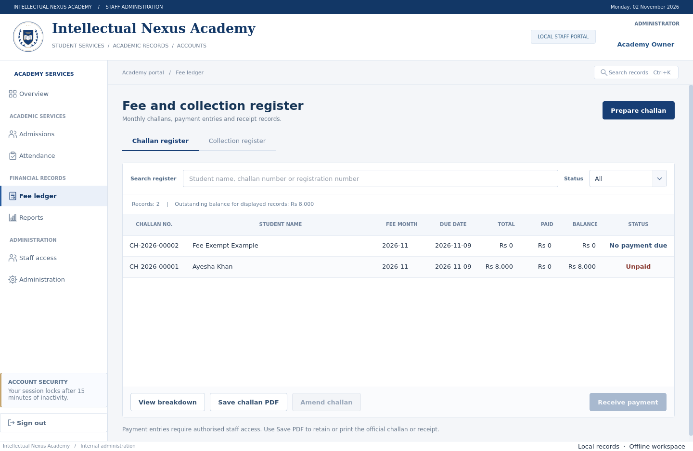
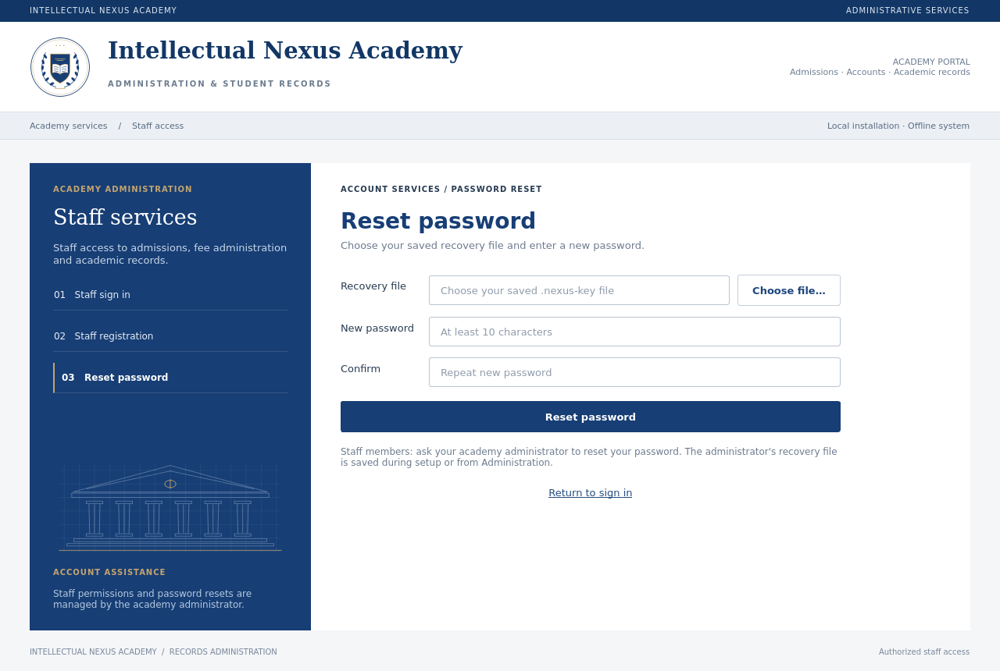

# Intellectual Nexus Academy · v1.1

An **offline desktop application** for one academy computer, built with Python, PySide6 and SQLite. Develop it in **PyCharm**, or build a Windows executable. Everyday admissions, billing, attendance and reporting need no Internet connection.

The blue/white institutional interface includes grouped office services, student and fee registers, and a settlement graphic calculated from actual challan balances. Both sign-in and administration windows open maximized. Version 1.1 adds a brief sign-in transition, hover/press feedback, smooth scrolling, page fades and confirmation before manual sign-out.


Preview records are fictional and are never installed. The original architectural artwork does not depict an actual campus.

## Download and Windows setup

On GitHub, choose **Code → Download ZIP** and extract the complete project. Alternatively open the repository through **PyCharm → Get from VCS**.

1. Install **64-bit Python 3.12** from [python.org](https://www.python.org/downloads/windows/) with the **Python Launcher** enabled. Confirm `py -3.12 --version` works.
2. Double-click **`setup_windows.bat`**. It creates or validates **`.venv312`**, then installs the pinned dependencies from `requirements.lock`. Internet is needed for the initial download.
3. Double-click **`run_windows.bat`**. It prefers `.venv312`; an older `.venv` is accepted only if its interpreter is Python 3.12.
4. On first use, enter academy details and create the owner account. Passwords need at least 10 characters. **No default username or password exists.**
5. Save the offered **`.nexus-key` password reset file** somewhere private, preferably on a separate drive.

An existing Python 3.14 `.venv` is preserved and is not used by these helpers. If `.venv312` itself contains the wrong interpreter or is incomplete, setup stops without deleting it: rename that folder to preserve its contents, then rerun setup. Installing Python 3.12 does not change an already-created virtual environment's interpreter.

### PyCharm

Open the project folder, then choose **Settings → Project → Python Interpreter → Add Local Interpreter → Existing** and select **`.venv312\Scripts\python.exe`**. Run `main.py` with the project folder as its working directory.

On macOS/Linux, use a Python 3.12 `.venv` and select `.venv/bin/python`. Interactive use requires a desktop display.

## Daily workflow

- **Staff access:** approve signup requests and assign receptionist, cashier or teacher roles, or create staff accounts directly. Signup cannot grant administrator access.
- **Admissions → Classes & batches:** register classes, standard fees/schedules and teacher assignments. Student profiles, their fee defaults and active status can be edited later.
- **New admission:** enter student/guardian details, choose a class, check tuition, admission fee, discount and due date. Saving atomically creates a unique student number and initial challan for the admission month.
- **Fee ledger:** inspect challans, export A4 PDF documents, and record payments. Admin/cashier chooses **Receive payment** and enters the amount/method. The balance changes from **Unpaid → Partially paid → Paid** as money is actually recorded.
- **Collection register:** export numbered receipt PDFs. For an incorrect payment, the administrator records a reversal reason, then enters the correct payment. Original payment records are retained.
- **Prepare challan:** issue a subsequent month's bill. There is one challan per student per fee month; bills are not created on a timer.
- **Attendance:** select a class/date, load its roster and save attendance. Teachers see only assigned classes.
- **Reports:** review collections and overdue fees, or export spreadsheet-safe CSV. **Administration** contains staff/audit/settings and consistent database backup/restore tools.

Duplicate-submit protection and overpayment checks protect collections. Bank transfer/card methods are **staff-confirmed records**; the app does not contact a bank or gateway. Open exported PDFs in your PDF reader to print or share them.

### Zero fees and correcting an unpaid bill

Enter the actual fee before saving an admission or challan. If charges are intentionally zero, explicitly select **Fee-exempt / no charges**. Such a bill displays **No payment due**; it never claims a payment was received and creates no receipt. This also applies when a discount reduces the total to zero.

**Existing zero-total bills are preserved** and now display **No payment due**. To correct an accidental zero or another incorrect uncollected amount, select the bill in **Fee ledger → Amend challan**, enter the corrected charges/due date and a reason, then save. The audit log records the old and new amounts. A positive bill with no payments becomes **Unpaid**.

Amendment is available only before **any payment has ever been recorded**, including payments later reversed. Received payments and their bill amounts are never silently rewritten. Changing a student's monthly fee changes **future billing defaults**, not an existing bill; use **Amend challan** for that bill. Changing a class default also leaves existing students' individual fee defaults unchanged. Inactive students and their financial history remain stored; outstanding fees remain payable.



### Keyboard and navigation

| Shortcut | Action |
| --- | --- |
| **Ctrl+K** | Search academy records within your account's permissions |
| **Ctrl+F** | Focus the current page's search field, where available |
| **Ctrl+R** | Refresh the current page |

Manual sign-out asks for confirmation. Fifteen minutes without keyboard/mouse input returns the app to sign-in automatically.

## Accounts and password reset files

The owner controls staff approval, roles, staff password resets and financial reversals. All staff can change their own password from their account button. Five failed authentication attempts temporarily lock an account for one minute. Passwords and the database's recovery verifier use Argon2id hashes.

For an owner who forgets their password:

1. On sign-in, choose **Forgot password? → Reset password**.
2. Select the saved **`.nexus-key`** file and enter/confirm a new password.
3. Sign in with the new password. **The same reset file remains usable** for a later reset.

No recovery codes are displayed or typed in this flow. There is no email reset service. Staff members ask the owner to reset their password.



**Existing owners upgrading from v1.0:** sign in normally, open **Administration → Owner account → Save password reset file…**, confirm the current password and save a file once. This also replaces a lost reset file. Successfully exporting a replacement **invalidates older reset files**; cancelled/failed saves leave the previous key valid. Choose a new filename; existing files are not overwritten.

A reset file grants access to the owner account. Keep it private and separate from the computer/database. A database backup is a different file and does not replace your password reset file. After restoring an older database backup, use the password or recovery file that matches that backup.

## Roles and scope

| Capability | Admin | Receptionist | Cashier | Teacher |
| --- | :---: | :---: | :---: | :---: |
| Student/class registration and editing | Yes | Yes | — | — |
| Challans, permitted amendments and PDFs | Yes | Yes | Yes | — |
| Receive payments | Yes | — | Yes | — |
| Reverse payments | Yes | — | — | — |
| Attendance | All classes | — | — | Assigned only |
| Financial reports/CSV | Yes | — | Yes | — |
| Staff, audit, settings and backup/restore | Yes | — | — | — |

This release focuses on admissions, fees and attendance. Exam results, expense/payroll accounting, document attachments, custom logo upload, bulk recurring billing and a student portal are not implemented. Automatic online payment verification and email/WhatsApp sending require separate integrations and Internet access.

## Data, backups and updating

Records live **outside the source folder, executable and virtual environment**:

- Windows: `%LOCALAPPDATA%\IntellectualNexusAcademy\academy.sqlite3`
- Linux: `${XDG_DATA_HOME:-~/.local/share}/IntellectualNexusAcademy/academy.sqlite3`
- macOS: `~/Library/Application Support/IntellectualNexusAcademy/academy.sqlite3`

For a separate workspace use `python main.py --data-dir "C:\AcademyData"`. Keep the live database on a **local disk**. One data folder is one academy workspace with its own accounts; a second instance using that folder is rejected. The app does not sync computers.

Use **Administration → Database backup & restore → Create database backup…** to save a new `.sqlite3` file on another drive. Do not copy only the live database while the app is open: committed records may also be in its SQLite WAL. The in-app backup handles this consistently. PDF exports and `.nexus-key` reset files are separate from database backups.

Restore validates the backup, saves a pre-restore copy under `pre_restore_backups` in the data folder, replaces the active records and signs out. Sign in with an account from that backup. The database and backup files are not encrypted; protect the computer account and backup drive.

**To update:** make an in-app backup first, close the application, then replace the project files or executable with the new version. Keep using the same data folder and launch arguments. Version 1.1 keeps the existing database schema and records; installing dependencies or replacing source/EXE files does not reset academy data. Do not delete the external data folder or create a second academy to perform an update.

Financial/audit timestamps are stored in UTC. Calendar dates and collection-month grouping follow the computer's local timezone; set its clock correctly.

## Build a Windows executable

On **Windows with Python 3.12**, double-click **`build_windows.bat`**. It runs setup without an extra pause, installs **PyInstaller 6.12.0** into `.venv312`, and builds a single windowed executable:

```text
dist\Intellectual Nexus Academy.exe
```

Equivalent PowerShell commands, after `setup_windows.bat` succeeds:

```powershell
.\.venv312\Scripts\python.exe -m pip install pyinstaller==6.12.0
.\.venv312\Scripts\python.exe -m PyInstaller --noconfirm --clean --onefile --windowed --name "Intellectual Nexus Academy" main.py
```

Use these explicit Python 3.12 commands; activating an old Python 3.14 `.venv` does not prepare the pinned build tools. Once packaged, the target computer does not need PyCharm or the project's virtual environment. Test the executable, PDFs and physical printing on the academy's Windows computer before replacing a working version. **Windows batch execution, Windows packaging and physical printing have not been validated in the Linux cloud environment.**

## Development and validation

```bash
python3.12 -m venv .venv
.venv/bin/python -m pip install -r requirements.lock
.venv/bin/python main.py
.venv/bin/python -m pytest -q
```

Windows uses `.venv312\Scripts\python.exe`. `requirements.txt` pins runtime dependencies; `requirements-dev.txt` adds pytest; `requirements.lock` pins the complete tested set. For a headless Linux runner:

```bash
QT_QPA_PLATFORM=offscreen .venv/bin/python -m pytest -q
```

Tests use temporary databases, real Qt widgets and Qt's PDF reader. They cover authorization, admission/payment transactions, zero-fee intent, bill amendments, idempotent collections, reversals, teacher attendance scope, reusable-file recovery/rotation, corrupt-backup rejection and PDF/report output. No real academy accounts are seeded.

```text
main.py                  Application entry point
nexus/app.py             Session lifecycle, idle lock, instance lock
nexus/services.py        SQLite, security, domain transactions, backup
nexus/exports.py         Local A4 PDF generation
nexus/ui/                Account access, registers, reports and administration
nexus/ui/motion.py        Local interaction and transition effects
tests/                   Service and desktop integration tests
```
