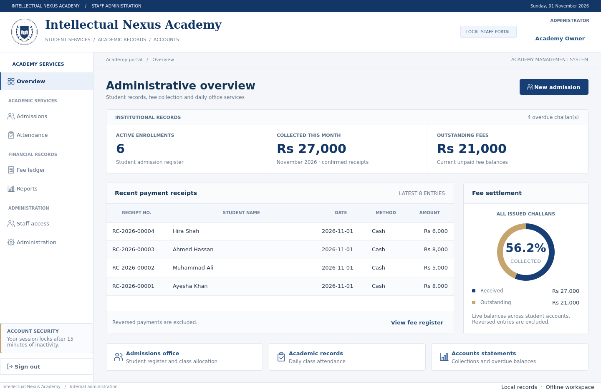
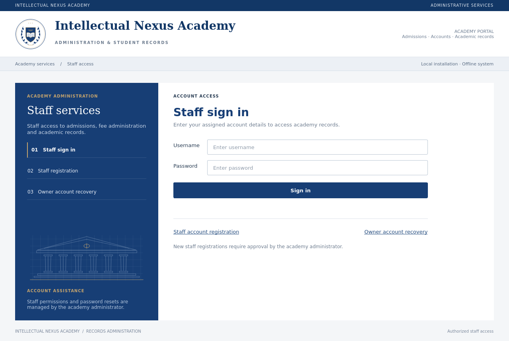

# Intellectual Nexus Academy

A professional **offline desktop application** for a single academy computer, built with Python, PySide6 and SQLite. Designed for development in **PyCharm**. No web server, cloud account, subscription or Internet connection is needed during everyday use.

## Interface

The administration workspace uses a blue/white institutional design with grouped office services, structured student/fee registers and an accurate fee-settlement summary. The account portal uses original academic architectural linework; it does not depict an actual campus. The preview records below are fictional and are never installed in the application.





## Get the project

When viewing this project on GitHub, choose **Code → Download ZIP**, extract the download and follow Windows setup below. Alternatively use **PyCharm → Get from VCS** with this repository's HTTPS address. Copying a truncated browser code preview does not produce a complete application.

## What works

- European institutional blue/white desktop workspace with an original academic emblem, serif masthead, grouped department navigation, structured registers and a live fee-settlement graphic based on actual challan balances.
- First-run academy/owner setup, login, staff signup pending approval, offline owner recovery and staff password resets.
- Administrator, receptionist, cashier and teacher roles enforced in the service layer as well as the interface.
- Classes/batches, schedules, teacher assignment, student admissions and editable student profiles/active status.
- Admission creates a unique student ID and initial fee challan atomically. Further monthly challans support tuition, other charges and discounts.
- Cashier records partial/full payments; the app calculates **Unpaid → Partially paid → Paid** automatically. Numbered receipts, duplicate-submit protection, overpayment prevention and audited admin reversals preserve the ledger.
- Printable A4 challan/receipt PDF files, including a clear reversed-receipt notice. Open saved PDFs in your PDF reader to print or share them.
- Assigned-class attendance, collection/overdue reports, spreadsheet-safe CSV export and an admin activity log.
- Consistent local/USB database backups, validated restore with a pre-restore safety copy, and a single-instance lock for each data folder.

This version focuses on admissions, fees and daily attendance. Exam results, expense/payroll accounting, document attachments, custom logo upload, bulk recurring billing and a student portal are not implemented. Payment methods such as bank transfer/card are **staff-confirmed entries**; no bank/gateway connection is made. Email/WhatsApp sending and automatic online payment verification need separate integrations and Internet access.

## Windows: easiest start

1. Install **64-bit Python 3.12** from [python.org](https://www.python.org/downloads/windows/) with the Python Launcher (`py`) enabled.
2. Extract/open this project in a normal folder.
3. Double-click **`setup_windows.bat`**. Internet is required once to download dependencies. Existing virtual environments are reused.
4. Double-click **`run_windows.bat`**. Everyday use is offline.
5. On the first screen, enter your academy information and create your owner account. Use a password of at least 10 characters. **There is no default username or password.**
6. Save the one-time owner recovery code privately, separately from the database/computer.

### Open in PyCharm

1. **File → Open** this project folder.
2. **Settings → Project → Python Interpreter → Add Local Interpreter → Existing** and choose `.venv\Scripts\python.exe` after Windows setup. Alternatively create a Python 3.12 virtual environment and run `python -m pip install -r requirements.lock` in its terminal.
3. Right-click **`main.py` → Run**. Set the working directory to this project folder.

On macOS/Linux, select `.venv/bin/python` instead. A desktop display is needed for interactive windows.

## First working day

1. **Staff access**: approve staff signup requests and assign their roles, or create staff accounts yourself. A signup cannot create an administrator.
2. **Admissions → Classes & batches**: create classes, set default fees/schedules, assign teachers. You can edit the assignment later.
3. **New admission**: enter student/guardian contact, choose a class, check tuition/admission fee/discount and the due date, then save. The student and first unpaid challan are created together.
4. **Fee ledger**: select the challan, inspect the breakdown or save its PDF. Admin/cashier selects **Receive payment**, records the amount/method and saves. A partial payment leaves the remaining balance outstanding.
5. **Collection register**: select the receipt and save its PDF. An incorrect payment can be reversed by the administrator with a reason; the original entry remains visible. Then record the correct payment.
6. **Prepare challan**: issue the next month's bill. One student can have only one challan per fee month; admission's first challan uses the admission month. Bills do not generate automatically on a timer.
7. **Attendance**: choose class/date, load the roster, mark attendance and save. Teacher accounts see only assigned classes.
8. **Administration**: make a backup to a separate drive regularly.

Changing a student's monthly fee or a class default affects future billing defaults; it does not rewrite old financial records. Editing a class default also leaves existing students' individual fees unchanged. Inactive students remain in history and outstanding fees remain payable.

## Roles

| Capability | Admin | Receptionist | Cashier | Teacher |
| --- | :---: | :---: | :---: | :---: |
| Admissions, student/class editing | Yes | Yes | — | — |
| Challans and PDF documents | Yes | Yes | Yes | — |
| Receive payments | Yes | — | Yes | — |
| Reverse payments | Yes | — | — | — |
| Attendance | All classes | — | — | Assigned only |
| Financial reports/CSV | Yes | — | Yes | — |
| Staff, audit log, settings, backup/restore | Yes | — | — | — |

All staff can change their own password using their account button. The app returns to login after 15 minutes without keyboard/mouse input. Five failed authentication attempts temporarily lock an account for one minute. Passwords and owner recovery codes use Argon2id hashes. The database itself is not encrypted: use an OS account/password and protect backup drives. Anyone with filesystem access to the database is outside the app's account-permission boundary.

## Data and recovery

Application records live outside the project and virtual environment:

- Windows: `%LOCALAPPDATA%\IntellectualNexusAcademy\academy.sqlite3`
- Linux: `${XDG_DATA_HOME:-~/.local/share}/IntellectualNexusAcademy/academy.sqlite3`
- macOS: `~/Library/Application Support/IntellectualNexusAcademy/academy.sqlite3`

For an isolated workspace, run `python main.py --data-dir "C:\AcademyData"` (or a local folder on your OS). Use a **local disk**, not a live database on a network/shared drive. One data folder is one academy workspace; each folder has its own accounts. A second app instance for the same folder is rejected.

Use **Administration → Database backup & restore → Create backup** to choose a new `.sqlite3` filename. Backups contain accounts, students, financial records, attendance and settings. PDFs are separate export files. Do not copy just the live database file while the app is open; SQLite may have a WAL file. The in-app backup includes committed data consistently.

Restore replaces current records, validates the backup first, retains a safety copy under `pre_restore_backups` inside the current data folder, then signs you out. Sign in with credentials from the restored backup. Choose only backups you trust, keep recovery codes private and test your backup procedure before relying on it. The app does not sync between computers.

Financial/audit timestamps are stored in UTC; admission/due/attendance dates use the computer's local calendar. Set the computer clock/timezone correctly.

## Developer commands

```bash
python3.12 -m venv .venv
.venv/bin/python -m pip install -r requirements.lock
.venv/bin/python main.py
.venv/bin/python -m pytest -q
```

Windows equivalents use `.venv\Scripts\python.exe`. `requirements.txt` contains runtime pins, `requirements-dev.txt` adds pytest, and `requirements.lock` pins the complete tested dependency set.

For CI/cloud machines without a display:

```bash
QT_QPA_PLATFORM=offscreen .venv/bin/python -m pytest -q
```

Tests use temporary databases, real Qt widgets and Qt's PDF reader. They exercise authorization, admission/payment transactions, partial/full fees, idempotent submissions, reversals, teacher scope, attendance, recovery rotation, corrupt-backup rejection, restore, PDF contents and reports. No real academy accounts are seeded by installation or tests.

## Optional Windows executable

Build on **Windows** with Python 3.12 after validating the source app there:

```powershell
.venv\Scripts\python.exe -m pip install pyinstaller==6.12.0
.venv\Scripts\python.exe -m PyInstaller --noconfirm --clean --windowed --name "Intellectual Nexus Academy" main.py
```

Distribute the entire `dist\Intellectual Nexus Academy` folder, not just its `.exe`. The virtual environment/PyCharm is not required on the target machine once packaged. Windows packaging and physical printing have not been validated in the Linux cloud environment; test them on the intended academy computer. Application data remains in the local data folder when upgrading the executable.

## Structure

```text
main.py                  PyCharm / executable entry point
nexus/app.py             Session lifecycle, idle lock, instance lock
nexus/services.py        SQLite schema, security, domain transactions, backup
nexus/exports.py         Local A4 PDF generation
nexus/ui/                Auth, dashboard, students, fees, attendance, admin
tests/                   Domain and real desktop integration tests
```
